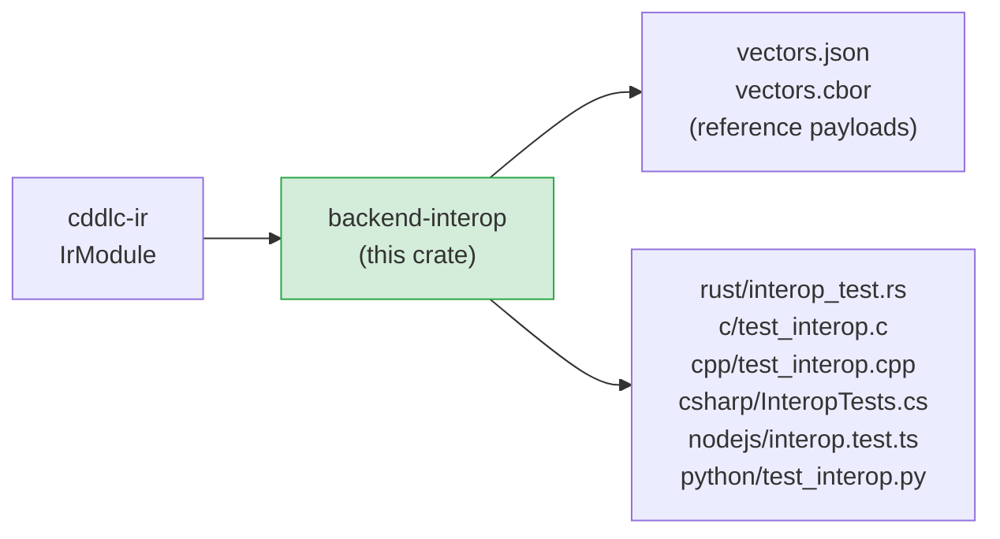
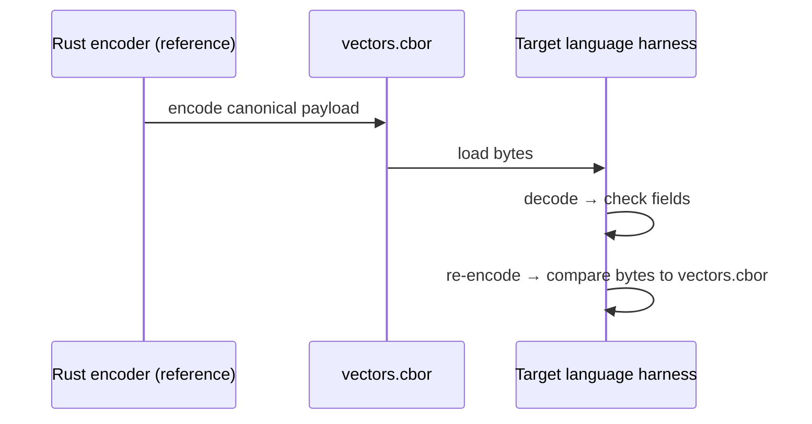

# backend-interop

Generates canonical CBOR test vectors — and per-language decode/roundtrip harnesses —
from an `IrModule`.  This lets you verify that a Rust encoder and a Python decoder (or any
other cross-language pair) agree on the wire format for the same CDDL schema.

## Position in the pipeline



## What it does

1. **Generates canonical CBOR payloads** (using the Rust encoder as the reference
   implementation) for every type in the schema.  Each type gets at least one test vector —
   a known-good encoding that all languages must decode correctly.

2. **Generates per-language harnesses** that load the vectors and verify:
   - **Decode**: each harness decodes the reference bytes and checks that field values match.
   - **Roundtrip**: each harness encodes the decoded value and verifies the re-encoded bytes
     are identical to the reference.

## Generated output layout

```
<output>/
  <module>-interop/
    vectors.json                  # human-readable test vectors (base64 CBOR)
    vectors.cbor                  # binary CBOR array of all vectors
    rust/
      interop_test.rs             # #[test] decode + roundtrip
    c/
      test_interop.c              # Unity decode + roundtrip tests
    cpp/
      test_interop.cpp            # Catch2 decode + roundtrip tests
    csharp/
      InteropTests.cs             # xUnit decode + roundtrip tests
    nodejs/
      interop.test.ts             # Jest decode + roundtrip tests
    python/
      test_interop.py             # pytest decode + roundtrip tests
```

## Triggering interop generation

Interop output is generated by passing `--interop` to the CLI:

```bash
cddlc my_schema.cddl --interop --interop-langs rust,python,nodejs -o generated/
```

The `--interop-langs` flag controls which per-language harnesses are generated.
Valid values: `rust`, `c`, `cpp`, `csharp`, `nodejs`, `python`.

## Vector format

`vectors.json` is a JSON object keyed by type name.  Each value contains the base64-encoded
CBOR payload and the expected field values in a language-neutral format:

```json
{
  "Device": {
    "cbor_b64": "oWJpZGRkZW1v",
    "fields": {
      "id":     "demo",
      "active": true
    }
  }
}
```

`vectors.cbor` encodes the same information as a CBOR map for use in languages where
JSON loading adds friction.

## Interop test flow



## Public API

```rust
/// Generate interop vectors and per-language harnesses.
pub fn generate(
    module: &IrModule,
    langs:  &InteropLangs,
    opts:   &CodegenOptions,
) -> Vec<CodegenFile>;

pub struct InteropLangs {
    pub rust:   bool,
    pub c:      bool,
    pub cpp:    bool,
    pub csharp: bool,
    pub nodejs: bool,
    pub python: bool,
}
```

## Known gaps and future enhancements

- **Dart harness not generated**: `InteropLangs` has no `dart` field; the Dart backend
  is not included in cross-language interop testing.
- **Reference encoder is Rust only**: the vector generation always uses the Rust backend.
  If there is a bug in the Rust encoder, all vectors will encode that bug.  An independent
  CBOR library (e.g. a Python script using `cbor2`) could serve as a second reference.
- **Single vector per type**: only one test vector is generated per type (a best-effort
  default value).  Edge-case vectors (max-size strings, all-optional fields absent, CBOR
  tagged values) would improve coverage.
- **No negative / error test vectors**: vectors only cover valid payloads; harnesses
  do not test that malformed input is rejected.
- **No streaming / incremental CBOR test**: all vectors are complete in-memory payloads;
  streaming / indefinite-length CBOR paths are not exercised.
- **No versioned vector files**: the vector format is not versioned; a schema change that
  alters encoding will silently invalidate existing vectors.

## License

MIT OR Apache-2.0
